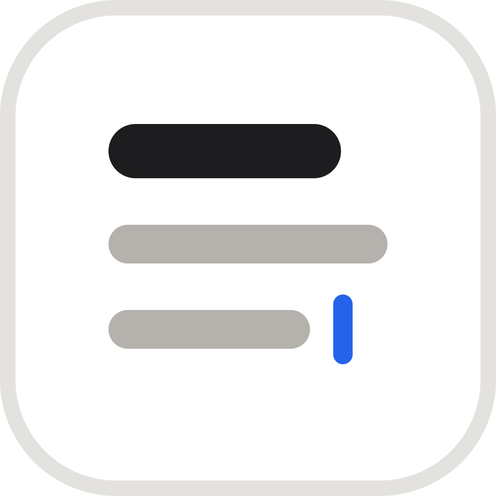
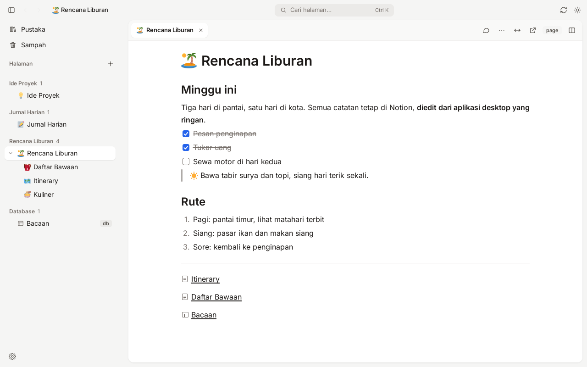
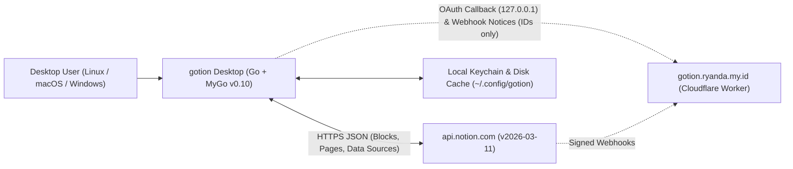

<a id="readme-top"></a>

<div align="center">



<h1>gotion</h1>

<p>
Open and edit your Notion pages in a native desktop app for Linux, macOS, and Windows.
<br>
Caches pages for offline work, syncs only the blocks you changed, and talks directly to the Notion API without a browser.
</p>

<p align="center">
  <a href="https://go.dev"></a>
  &nbsp;&nbsp;&nbsp;
  <a href="https://developers.notion.com"><picture><source media="(prefers-color-scheme: dark)" srcset="https://cdn.simpleicons.org/notion/EDEDEC"></picture></a>
  &nbsp;&nbsp;&nbsp;
  <a href="https://workers.cloudflare.com"></a>
  &nbsp;&nbsp;&nbsp;
  <a href="https://github.com/ryandaaa/gotion-native/actions"></a>
  &nbsp;&nbsp;&nbsp;
  <a href="#install"><picture><source media="(prefers-color-scheme: dark)" srcset="https://cdn.simpleicons.org/linux/FCC624"></picture></a>
  &nbsp;&nbsp;&nbsp;
  <a href="#install"><picture><source media="(prefers-color-scheme: dark)" srcset="https://cdn.simpleicons.org/apple/EDEDEC"></picture></a>
  &nbsp;&nbsp;&nbsp;
  <a href="#install"></a>
</p>

<p>
  <sub>Built with <a href="https://go.dev">Go 1.27</a> · <a href="https://github.com/egoist/mygo">MyGo v0.10</a> · <a href="https://developers.notion.com">Notion API 2026-03-11</a> · <a href="https://workers.cloudflare.com">Cloudflare Workers</a></sub>
</p>

<p>
  <a href="https://github.com/ryandaaa/gotion-native/actions/workflows/test.yml"></a>
  <a href="https://github.com/ryandaaa/gotion-native/releases"></a>
</p>

<p>
  <a href="https://gotion.ryanda.my.id"><b>Website</b></a> ·
  <a href="#features">Features</a> ·
  <a href="#install">Install</a> ·
  <a href="#keyboard-shortcuts">Shortcuts</a> ·
  <a href="#architecture">Architecture</a> ·
  <a href="#build-from-source">Build</a> ·
  <a href="#faq">FAQ</a>
</p>

</div>

<div align="center">
  <picture>
    <source media="(prefers-color-scheme: dark)" srcset="worker/public/hero-dark.png">
    <source media="(prefers-color-scheme: light)" srcset="worker/public/hero-light.png">
    
  </picture>
</div>

<br>

<details>
<summary><b>Bahasa Indonesia</b> · Ringkasan singkat dan cara pasang</summary>

**gotion** adalah aplikasi desktop native (Go + MyGo) untuk membuka dan mengedit halaman serta database Notion tanpa browser. Aplikasi ini menyimpan halaman yang sudah dibuka ke disk agar tetap bisa diedit saat offline, lalu mengirim perubahan ke Notion API (`2026-03-11`) secara langsung per block yang berubah.

- **Pasang cepat di Linux (`~/.local`)**:
  ```sh
  curl -fsSL https://gotion.ryanda.my.id/download/install.sh | sh
  ```
- **Platform lain & installer**: buka [gotion.ryanda.my.id](https://gotion.ryanda.my.id) atau lihat bagian [Install](#install) untuk macOS (`.dmg`), Windows installer, dan paket `.deb` / `.rpm`.
- **Dua bahasa bawaan**: antarmuka tersedia dalam Bahasa Indonesia dan English (mengikuti bahasa sistem atau dipilih di Pengaturan).

</details>

## Features

<table width="100%">
<tr>
<td valign="top" width="50%">

**Block-accurate editor**

Write headings (`H1` to `H3`), checklists, bulleted and numbered lists, quotes, code blocks, and dividers. Type `/` for the block menu or `@` to mention pages and workspace members, style selections with the floating format bar, and edit page covers and emoji icons. Each paragraph tracks its Notion block ID, so updates patch only modified blocks while keeping unsupported blocks intact.

</td>
<td valign="top" width="50%">

**Databases as tables or cards**

Switch between sticky-header tables and card galleries per database. Rename database titles inline, filter and sort via server-side queries, edit status/select/multi-select chips, checkboxes, numbers, links, people, and relations in place, pick dates from an interactive calendar formatted as `DD Month YYYY`, create rows from templates, and add, rename, or delete columns.

</td>
</tr>
<tr>
<td valign="top" width="50%">

**Offline cache and live sync**

Pages you open stay cached locally on disk (`pages.json` and per-page cache), so reading and editing keep working when you lose connectivity. Pending block edits flush automatically 1.5 seconds after typing pauses (or every 5 seconds of continuous typing), while an optional Cloudflare Worker webhook relay pushes workspace change notices to refresh the sidebar and comments.

</td>
<td valign="top" width="50%">

**Desktop workspace layout**

Split the window into two resizable panels with independent tab strips and unsaved-edit indicators. Jump across pages with the command switcher, import and export Markdown files, recover pages trashed from gotion within 30 days, choose from 6 background washes in light, dark, or system themes, and switch between English and Bahasa Indonesia.

</td>
</tr>
<tr>
<td valign="top" width="50%">

**Today, at a glance**

A Today view gathers rows assigned to you from every database: a week strip with dots per day, one focus card for the most urgent task, the rest as small cards, and quick add. Mark tasks done or move them to tomorrow in place. Databases also show as a Board grouped by status, or as a Calendar where rows drag between days and ranges keep their length.

</td>
<td valign="top" width="50%">

**Tray, reminders, and quick capture**

Optionally keep gotion in the tray with a badge of today's tasks, a morning summary, reminders 15 minutes before timed tasks, and notifications for new comments that mention you or land on your pages. A global shortcut opens a small capture window that saves to your Inbox database, queueing offline. A right pane shows the page outline, comments, page info, or a preview of the selected row.

</td>
</tr>
</table>

## Install

<details open>
<summary><b>Linux</b> (<code>x86_64</code> and <code>arm64</code>)</summary>

Install into `~/.local` with the release script:

```sh
curl -fsSL https://gotion.ryanda.my.id/download/install.sh | sh
```

Or download a packaged release directly:
- [Debian / Ubuntu `.deb` (`x86_64`)](https://gotion.ryanda.my.id/download/linux-deb)
- [Fedora `.rpm` (`x86_64`)](https://gotion.ryanda.my.id/download/linux-rpm)
- [Archive `.tar.gz` (`x86_64`)](https://gotion.ryanda.my.id/download/linux-tar)
- For `arm64` Linux builds, download from [GitHub Releases](https://github.com/ryandaaa/gotion-native/releases).

</details>

<details>
<summary><b>macOS</b> (Apple silicon and Intel)</summary>

Download the `.dmg` matching your Mac chip and drag **gotion** into Applications:
- [Apple silicon (M1+) `.dmg`](https://gotion.ryanda.my.id/download/mac)
- [Intel `.dmg`](https://gotion.ryanda.my.id/download/mac-intel)

Because release binaries are not Apple code-signed yet, open **System Settings -> Privacy & Security** and click **Open Anyway** on first launch.

</details>

<details>
<summary><b>Windows</b> (<code>x64</code> and <code>ARM64</code>)</summary>

Run the installer for your architecture:
- [Windows 64-bit (`x64`) installer](https://gotion.ryanda.my.id/download/windows)
- [Windows ARM64 installer](https://gotion.ryanda.my.id/download/windows-arm)

If Windows SmartScreen warns about an unknown publisher, click **More info**, then **Run anyway**.

</details>

> [!NOTE]
> gotion offers two sign-in methods on first launch:
> 1. **Sign in with Notion (OAuth):** Opens Notion's permission screen in your browser, returns tokens over `127.0.0.1`, and saves credentials in your OS keychain (with fallback to the user config directory on Linux without a Secret Service).
> 2. **Internal Integration Token (`ntn_...`):** Paste your own Notion integration secret to talk directly to `api.notion.com` with zero intermediate servers.

## Keyboard shortcuts

On macOS, `Cmd` replaces `Ctrl` for window and formatting shortcuts.

| Shortcut | Action | Scope |
|---|---|---|
| <kbd>Ctrl</kbd>+<kbd>K</kbd> or <kbd>Ctrl</kbd>+<kbd>P</kbd> | Open quick page switcher | Global |
| <kbd>Ctrl</kbd>+<kbd>N</kbd> | Create subpage inside current page | Global |
| <kbd>Ctrl</kbd>+<kbd>\\</kbd> | Toggle sidebar | Global |
| <kbd>Ctrl</kbd>+<kbd>Shift</kbd>+<kbd>.</kbd> | Toggle right pane (outline, comments, row preview) | Global |
| <kbd>Ctrl</kbd>+<kbd>Shift</kbd>+<kbd>Space</kbd> | Quick capture, even when gotion is in the background (changeable in Settings) | System |
| <kbd>Ctrl</kbd>+<kbd>W</kbd> | Close active tab | Panel |
| <kbd>Ctrl</kbd>+<kbd>Tab</kbd> / <kbd>Ctrl</kbd>+<kbd>Shift</kbd>+<kbd>Tab</kbd> | Switch between tabs | Panel |
| <kbd>Ctrl</kbd>+<kbd>[</kbd> or <kbd>Alt</kbd>+<kbd>Left</kbd> | Navigate back | History |
| <kbd>Ctrl</kbd>+<kbd>]</kbd> or <kbd>Alt</kbd>+<kbd>Right</kbd> | Navigate forward | History |
| <kbd>Ctrl</kbd>+<kbd>Shift</kbd>+<kbd>L</kbd> | Cycle theme (`system`, `light`, `dark`) | Appearance |
| <kbd>Ctrl</kbd>+<kbd>R</kbd> | Reload pages from Notion | Workspace |
| <kbd>Ctrl</kbd>+<kbd>,</kbd> | Open settings | App |
| <kbd>Ctrl</kbd>+<kbd>=</kbd> / <kbd>Ctrl</kbd>+<kbd>-</kbd> / <kbd>Ctrl</kbd>+<kbd>0</kbd> | Zoom in, out, or reset to 100% | Window |
| <kbd>Ctrl</kbd>+Click | Open page or database in second panel | Sidebar & switcher |

<details>
<summary><b>Editor, slash menu, and comments shortcuts</b></summary>

| Input | Action |
|---|---|
| `/` at start of line | Open slash command menu (`↑↓` move, `Enter` insert, `Esc` close) |
| `@` while typing | Mention a Notion page or workspace member |
| <kbd>Ctrl</kbd>+<kbd>B</kbd> | Toggle bold |
| <kbd>Ctrl</kbd>+<kbd>I</kbd> | Toggle italic |
| <kbd>Ctrl</kbd>+<kbd>U</kbd> | Toggle underline |
| <kbd>Ctrl</kbd>+<kbd>E</kbd> | Toggle inline code |
| <kbd>Ctrl</kbd>+<kbd>K</kbd> | Set or edit hyperlink on selected text |
| <kbd>Ctrl</kbd>+<kbd>Enter</kbd> | Send comment or reply in the comments pane |

</details>

## Architecture

gotion separates UI rendering, rich-text block mapping, background sync, and Notion REST calls into focused Go packages, paired with a small Cloudflare Worker for OAuth token exchange and optional signed webhook notifications.



<details>
<summary><b>Repository layout</b> (Go packages, tools, and Worker)</summary>

| Path | Responsibility |
|---|---|
| `main.go` | Window lifecycle, font loading, cache paths, language setup, and auto-updater hook |
| `internal/app` | MyGo native UI: panels, tabs, sidebar, block editor, database table/cards, calendar date picker, settings |
| `internal/doc` | Bidirectional converter between Notion blocks (`Block`) and `richtext.Document` paragraphs |
| `internal/syncer` | Debounced diff-and-patch sync engine, offline disk cache, and polling/remote update loop |
| `internal/notion` | Notion REST client (`2026-03-11`) with token-bucket rate limiter, retries, property formatters, and schemas |
| `internal/tr` | Indonesian (`id`) and English (`en`) translation dictionary with AST coverage tests |
| `internal/emoji` | Twemoji asset loader and cache for page icons and inline emojis |
| `tools/icon` | Generator for the application icon (`resources/icon.png`) and favicon |
| [`worker/`](worker/README.md) | Cloudflare Worker for OAuth loopback, `/refresh`, signed Notion `/webhook` relay, and landing pages |

</details>

## Build from source

**Prerequisites:** Go `1.27.3+` (defined in `go.mod`). Running Worker tests also requires Node.js.

Run the desktop client locally:

```sh
go run .
```

Run static checks and the test suite (Desktop + Worker):

```sh
go vet ./... && go test ./... && node worker/test.mjs
```

Build release bundles with MyGo (`linux/amd64`, `linux/arm64`, `darwin/arm64`, `darwin/amd64`, `windows/amd64`, `windows/arm64`):

```sh
go tool mygo build -platform linux/amd64
```

<details>
<summary><b>Advanced build options: headless UI screenshots & self-hosted OAuth Worker</b></summary>

1. **Render UI inspection screenshots** without launching a GUI window:
   ```sh
   SHOT=/tmp/gotion-shots go test ./internal/app -run TestShot
   ```
2. **Point gotion at your own OAuth Worker** (see [`worker/README.md`](worker/README.md) for deployment steps):
   ```sh
   GOTION_OAUTH_URL=https://auth.example.com go run .
   # Or embed at compile time:
   go build -ldflags "-X gotion/internal/app.OAuthURL=https://auth.example.com" .
   ```

</details>

## FAQ

<details>
<summary>Do my Notion pages go through gotion's server?</summary>

No. The desktop app connects directly to `api.notion.com`. The Cloudflare Worker at `gotion.ryanda.my.id` handles only OAuth login completion (`127.0.0.1` loopback), token refresh, and relaying signed Notion webhook IDs (page IDs, never page text or properties).

</details>

<details>
<summary>Where are my token and cached pages stored?</summary>

Credentials are stored in your system keychain via MyGo Secrets (falling back to a `0600` file inside your user config directory if no Secret Service is present on Linux). Settings, the page tree (`pages.json`), cached pages, and downloaded Twemoji images live under your OS config directory (such as `~/.config/gotion/` on Linux).

</details>

<details>
<summary>What happens to complex Notion blocks that gotion does not edit?</summary>

gotion maps editable text blocks 1:1 by block ID and leaves unsupported or deeply nested blocks intact on Notion. Uneditable blocks show a link back to open them on `notion.so`.

</details>

<details>
<summary>How do automatic updates work?</summary>

Tagged release builds (`v*`) built through `.github/workflows/release.yml` check GitHub Releases via MyGo's signed updater plugin. Development builds (`go run .` or `go build .`) keep the updater disabled and link to [gotion.ryanda.my.id](https://gotion.ryanda.my.id).

</details>

---

**Credits & notices:** Built with [MyGo](https://github.com/egoist/mygo) (MIT), [Inter](https://rsms.me/inter/) (SIL Open Font License 1.1), and [Twemoji](https://github.com/jdecked/twemoji) (CC-BY 4.0). `Copyright © 2026 Ryanda`. gotion is an independent client using Notion's public API and is not affiliated with Notion Labs, Inc.

<p align="right"><a href="#readme-top">↑ Back to top</a></p>
